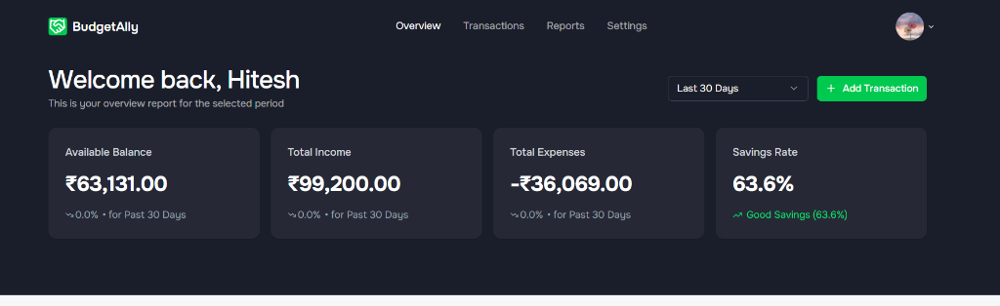
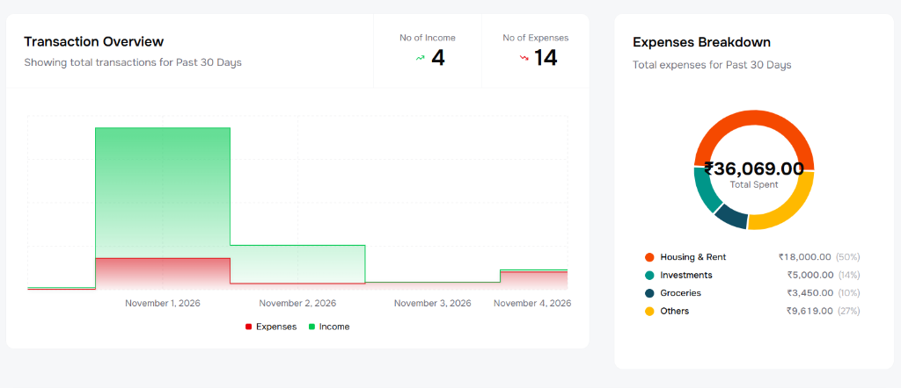
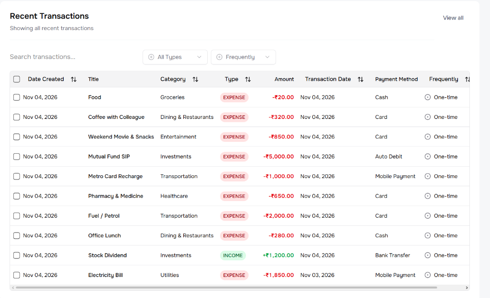
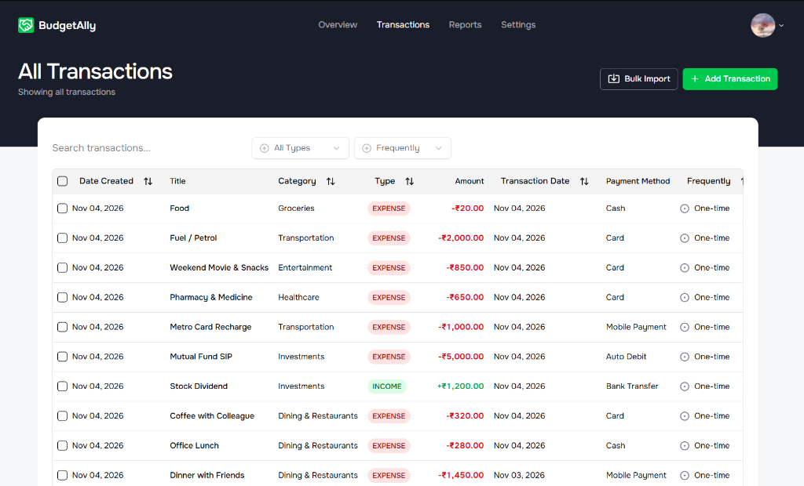
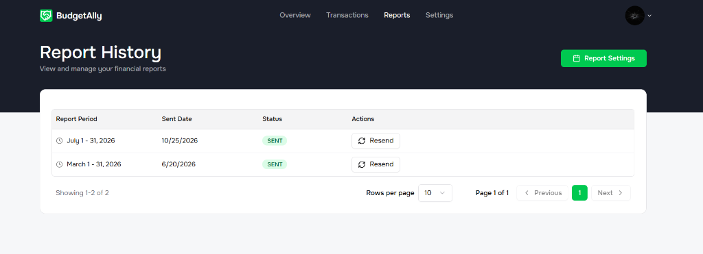
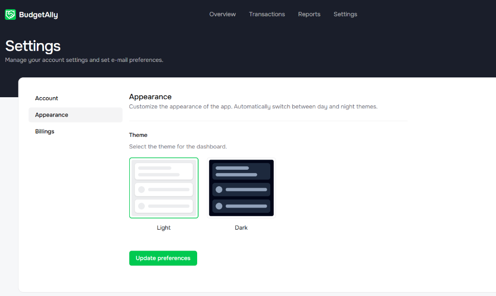
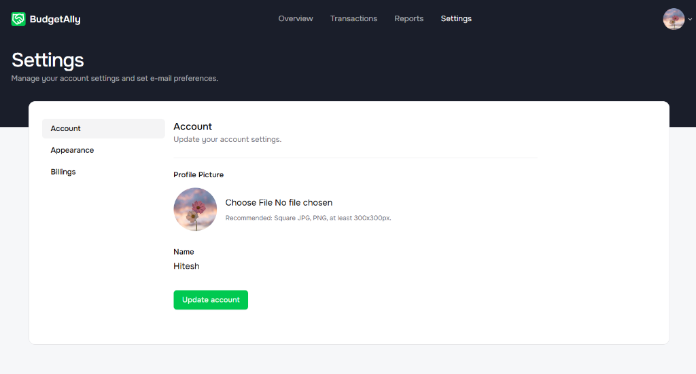

# 💰 BudgetAlly - Personal Finance & Budget Management App


A modern, full-stack personal finance and budget management application designed to help users take control of their financial health. BudgetAlly goes beyond simple tracking by integrating **AI-powered receipt scanning (Google Gemini)**, **bulk CSV transaction imports**, **recurring transaction automation**, and **advanced analytics** with interactive charts in Indian Rupee (₹) formatting.

---

## 📸 Feature Showcase & Screenshots

### 1. 📊 Financial Overview Dashboard
Real-time summary cards displaying **Available Balance**, **Total Income**, **Total Expenses**, and **Savings Rate** with preset date range filtering (Last 30 Days, This Month, All Time) and responsive typography.



---

### 2. 📈 Interactive Analytics & Expenses Breakdown
Visual analytics powered by MongoDB aggregation pipelines and Recharts:
* **Transaction Overview:** Cash flow area chart comparing income vs. expenses over time.
* **Expenses Breakdown:** Category donut chart with dynamic center totals and detailed legend percentages.



---

### 3. 🕒 Recent Transactions & Live Feed
Quick-glance recent activity table on the main dashboard with instant search, type filters, and color-coded transaction badges.



---

### 4. 💳 Comprehensive Transactions Management & Bulk Import
Manage all historical records with advanced capabilities:
* **Bulk CSV Import:** Upload and column-map CSV files with auto-validation for up to 300 transactions at once.
* **Smart Search & Filters:** Filter by income, expense, payment method (Card, UPI, Cash, Bank Transfer), and frequency.
* **CRUD Operations:** Add, edit, duplicate, and bulk delete transactions.



---

### 5. 📑 Automated Financial Reports & History
Track scheduled monthly summary reports sent to your email, check delivery status, and re-trigger reports on demand.



---

### 6. 🎨 Appearance & Theme Preferences
Switch seamlessly between Light and Dark themes according to your preference.



---

### 7. 👤 User Account & Profile Settings
Customize your user profile with profile picture upload (Cloudinary cloud storage) and update account information.



---

## 🌟 Key Features

* **🔐 Secure Authentication:** Robust user authentication and registration with **JWT (JSON Web Tokens)** and bcrypt password hashing.
* **🤖 AI-Powered Receipt Scanner:** Upload receipts (JPG, PNG, WebP up to 10MB) to automatically extract merchant, date, amount, category, and payment method via **Google Gemini API**.
* **📥 Bulk CSV Import:** Fast batch import modal with column mapping and schema validation.
* **📊 Visual Financial Intelligence:** Dynamic charts, savings metrics, and monthly aggregations.
* **🔄 Recurring Transactions:** Automate recurring expenses and income (Daily, Weekly, Monthly, Yearly).
* **🇮🇳 Indian Rupee (₹) Formatting:** Compact Lakh/Crore notation for large sums with full rupee-and-paisa hover tooltips.
* **📱 Responsive Design:** Adaptive layouts optimized for mobile phones, tablets, laptops, and wide screens.

---

## 🛠️ Tech Stack

**Frontend:**
* **Framework:** React.js (Vite)
* **Language:** TypeScript
* **State Management:** Redux Toolkit & RTK Query
* **Styling:** Tailwind CSS & Shadcn UI
* **Charts:** Recharts
* **Forms & Validation:** React Hook Form & Zod

**Backend:**
* **Runtime:** Node.js
* **Framework:** Express.js
* **Database:** MongoDB (Mongoose ODM)
* **Authentication:** JWT & Bcrypt
* **AI Integration:** Google Gemini API (`@google/genai`)
* **Cloud Storage:** Cloudinary & Multer

---

## 📂 Project Structure

```bash
Personal-Budget-App/
├── backend/                  # Node.js & Express API server
│   ├── src/
│   │   ├── config/           # Database, Cloudinary & Gemini AI configs
│   │   ├── controllers/      # Route controllers (Auth, Transaction, Analytics)
│   │   ├── crons/            # Automated background scheduled jobs
│   │   ├── models/           # Mongoose schemas & setters/getters
│   │   ├── routes/           # Express API endpoints
│   │   ├── services/         # Business logic & aggregation pipelines
│   │   └── validators/       # Zod request validators
├── frontend/                 # React & Vite application
│   ├── src/
│   │   ├── components/       # UI components, data table & modal dialogs
│   │   ├── features/         # RTK Query API slices & types
│   │   ├── pages/            # Dashboard, Transactions, Reports, Settings
│   │   └── lib/              # Currency & percentage formatters
├── screenshots/              # Application feature showcase screenshots
├── sample_transactions.csv   # Ready-to-use sample CSV for bulk import testing
└── README.md
```

---

## 🚀 Getting Started

Follow these steps to run BudgetAlly locally on your machine.

### Prerequisites
* **Node.js** (v18 or higher recommended)
* **MongoDB** (Local instance or MongoDB Atlas URI)
* **npm** or **yarn**

---

### 1. Clone the Repository
```bash
git clone https://github.com/ArchitaSarkar/Personal-Budget-App.git
cd Personal-Budget-App
```

---

### 2. Backend Setup
Navigate to the backend folder and install dependencies:
```bash
cd backend
npm install
```

Create a `.env` file in the `backend/` directory:
```env
PORT=8000
NODE_ENV=development
MONGO_URI=your_mongodb_connection_string
JWT_SECRET=your_jwt_secret_key
JWT_EXPIRES_IN=7d
GEMINI_API_KEY=your_gemini_api_key
CLOUDINARY_CLOUD_NAME=your_cloudinary_name
CLOUDINARY_API_KEY=your_cloudinary_api_key
CLOUDINARY_API_SECRET=your_cloudinary_api_secret
FRONTEND_ORIGIN=http://localhost:5173
```

Start the backend server:
```bash
npm run dev
```
> The backend server will start on **http://localhost:8000**.

---

### 3. Frontend Setup
Open a new terminal, navigate to the frontend folder, and install dependencies:
```bash
cd ../frontend
npm install
```

Start the React development server:
```bash
npm run dev
```
> The frontend application will be running on **http://localhost:5173**!

---

## 📡 API Endpoints

| Method | Endpoint | Description |
| :--- | :--- | :--- |
| **POST** | `/api/auth/register` | Register a new user |
| **POST** | `/api/auth/login` | Login user & receive JWT session |
| **POST** | `/api/auth/logout` | Clear user session |
| **GET** | `/api/transaction/all` | Get paginated transactions with search & filters |
| **POST** | `/api/transaction/create` | Add a new transaction |
| **PUT** | `/api/transaction/update/:id` | Update an existing transaction |
| **DELETE**| `/api/transaction/delete/:id` | Delete a single transaction |
| **POST** | `/api/transaction/bulk-transaction` | Bulk import transactions from CSV |
| **DELETE**| `/api/transaction/bulk-delete` | Bulk delete selected transactions |
| **POST** | `/api/transaction/scan-receipt` | Upload & parse receipt image with AI |
| **GET** | `/api/analytics/summary` | Summary stats (Income, Expenses, Savings Rate) |
| **GET** | `/api/analytics/chart` | Cash flow overview area chart data |
| **GET** | `/api/analytics/expense-pie-chart` | Expense category breakdown donut chart |

---

## 👤 Author

**Archita Sarkar**
* GitHub: [@ArchitaSarkar](https://github.com/ArchitaSarkar)
* LinkedIn: [Archita Sarkar](https://www.linkedin.com/in/archita-sarkar-010421308)

---
*If you find this project useful, please consider giving it a ⭐!*
